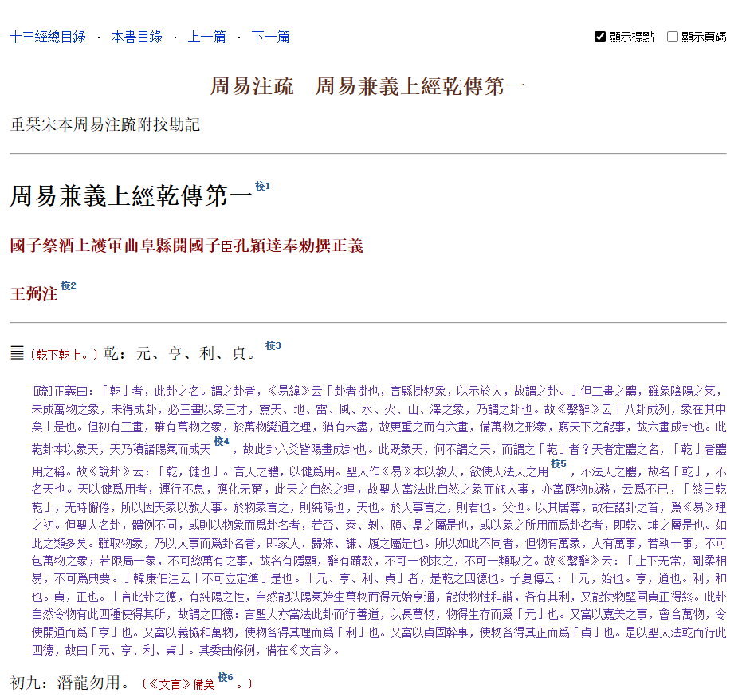

## 重栞宋本十三經注疏 標點本

原始文本来自 <a href="https://www.donglishuzhai.net/tags/%E9%98%AE%E5%88%BB%E5%8D%81%E4%B8%89%E7%B6%93%E6%B3%A8%E7%96%8F/">東里書齋・阮刻十三經注疏</a>，标点符号提取自 wikisource 上的十三经文本，批量自动添加，对于某些无法程序添加的标点，由ai补充完善。一些偶尔发现的错误，则会手工修正。

标点符号和原始页码均可设置显示或者隐藏。

